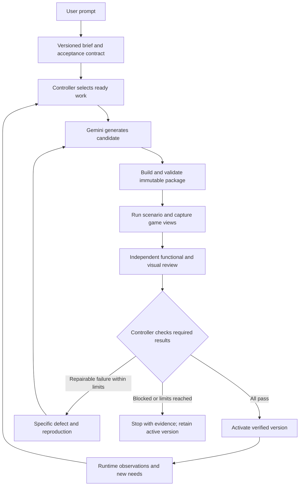

# Living Empires

A game that agents build, inspect, play, and improve against explicit acceptance criteria. A user describes what they want; Gemini produces a candidate; independent reviewers examine the running game; failures become bounded repair jobs; only verified versions reach players.

**Current deliverable: the asset generator.** The existing `living-world-core` Rust crate now owns generation/provider requests, rehearsal generation and repair, frozen theme/job contracts, bounded acceptance decisions, and versioned asset export. Node supplies HTTP, persistence and browser-renderer transport; Three.js supplies the actual test scene. The unified offline lifecycle passes with real Rust checks, browser captures, package export, activation, cancellation, and rollback; generation and visual verdicts in rehearsal mode remain explicitly simulated. The native Gemini HTTP feature compiles and provider tests use mocked transport. An earlier managed creator probe succeeded through the previous adapter; the native live generation–independent image review–repair lifecycle remains unverified. The 122-criterion multiplayer game below remains downstream scope.

Theme contracts are editable and include biome, silhouette, material finish/weathering, construction technology, motifs, lighting, scale, sensor-building role, exclusions, observable visual checks, assumptions and renderer limitations. [Compare the three authored preset structures](http://127.0.0.1:4317/comparison.html): a ceramic relay (12 parts), timber pavilion (11), and fortified basalt station (14). Their geometry and material response differ. Fine scratches, moss textures and heat cracks remain design metadata. A local prompt draft uses labeled keyword/preset selection; live Gemini theme resolution is prepared but disabled by default until its spending ceiling is approved.

## Run the prototype

Requires Node.js 22+, npm, a stable Rust toolchain, and a Gemini API key for live generation. The local server binds only to loopback; no public deployment is configured.

```sh
npm install
npm run build:core
cp .env.example .env
# Set GEMINI_API_KEY in .env. Never commit this file.
npm run dev
```

Open the printed local URL (default `http://127.0.0.1:4317`) in the in-app browser and keep it open: the Studio browser is the primary asset renderer. **Chromium installation is optional** and only needed to capture without an open Studio. Choose a theme and edit the brief. Use **Gemini managed agent** for the intended managed workflow, **Gemini direct** for the smaller recipe-generation path, or **Offline rehearsal** for a clearly labeled fixture demonstration without API calls. Both live modes use a separate Gemini image review. The theme freezes when a job starts; generated geometry must use its saved material palette, and visual review also checks architectural/biome consistency.

Optional headless-renderer setup:

```sh
PLAYWRIGHT_BROWSERS_PATH=.data/browsers npx playwright install chromium
# AUDIT_RENDERER=headless npm run dev
```

The optional challenge checkbox inserts a blocked entrance after initial generation. The runner records three actual rendered views, the Rust core rejects blocked traversal, and the repair receives the observed failure. Click **Activate** only after the candidate passes all six demo gates. Download the approved asset package for game consumption: `GET /api/jobs/{id}/package` returns a versioned recipe, frozen theme, manifest, required checks, content hash, and evidence hashes. Rehearsal packages carry `manifest.rehearsal: true`. Rollback becomes available after two releases. Run limits are three candidates, six live API calls, and twenty minutes per job; this is a call ceiling, not a guaranteed monetary spending cap. There are no hidden request retries.

Keep the Studio open while running: its browser worker can render the exact job/attempt/hash offscreen and return three actual PNG views plus a collision-aware movement trace. The controller validates the token and Rust parity, fingerprints evidence, and rejects stale/cancelled submissions. This fallback avoids blocking on a headless-browser download. Headless capture is used when no Studio worker is connected; `AUDIT_RENDERER=headless` forces it. The visible asset preview stays separate from audit rendering.

```sh
npm run test:core
npm test
# With the local server running; uses fixture generation/review, real Rust checks and game renders:
npm run test:e2e
```

Our [`living-world-core`](crates/living-world-core/README.md) crate contains internal `provider` and `pipeline` modules alongside recipe validation and collision simulation. `provider` constructs Gemini requests, parses replies, supplies a native optional HTTP transport and owns fixture generation/repair. `pipeline::AssetPipeline` freezes and hashes contracts, counts attempts/calls, accepts independent evidence, decides repair/approval, enforces cancellation and produces `ApprovedAssetPackage`. The `world-check` JSON boundary exposes create, fixture, generate, review, submit, charge, decide, cancel and package operations. Node does not independently approve new jobs; it asks Rust and uses Rust-returned hashes. Legacy saved packages remain readable through a compatibility path. The app build uses `--features live-provider`; the offline library can also build without network transport. Build output goes in ignored `target/`; the crate and Cargo lockfile stay here. `RUST_CORE_BIN` can override the binary path.

Runs, rejected versions, provider responses, screenshots, and release manifests persist under ignored `.data/`. On restart, an unfinished paid operation is marked blocked for reconciliation. Credentials stay in ignored `.env` and are sent only from the backend to Google's API. The first demo does not yet implement free-form terrain generation, unit manufacture/economy, multiplayer, automatic production deployment, or the full long-run acceptance audit.

[Original concept document](https://docs.google.com/document/d/1mqgO7fSls-Rl7Pj60cTtoMFihdOzq9y89seT2yHz0bA/edit?tab=t.0) · [Full game acceptance criteria](#living-empires-game-acceptance-criteria)

## Recommended architecture

Use **Gemini managed agents for generation and repair, plus a small application-owned controller for acceptance, budgets, and release**. AI Studio is useful for developing agent instructions; the backend invokes agents through the API so each job can be resumed, measured, and audited.

Google documents `antigravity-preview-09-2026` as the managed agent identifier. It is invoked through the Interactions API, which supplies a remote Linux environment. Keep both the interaction ID and environment ID when continuing a repair session: conversation context and workspace state are separate. Download produced files into our own versioned artifact store before testing them. Verify project access and the chosen SDK version with a small live smoke test before building around this preview. [Managed agents quickstart](https://ai.google.dev/gemini-api/docs/managed-agents-quickstart.md)

The managed agent supports custom instructions, mounted skill files, custom functions, and remote MCP tools. Define separate creator and reviewer configurations with different tool access. The agent identifier and underlying Gemini model are separate configuration choices; record both per run. [Building managed agents](https://ai.google.dev/gemini-api/docs/custom-agents)

Start with a TypeScript backend, the Google GenAI SDK, SQLite for durable jobs/results, a filesystem artifact store, and Playwright to exercise a browser game. Use Three.js for the proposed 3D client and a deterministic authoritative simulation. Introduce a hosted database, object storage, and a distributed queue when more than one worker needs them. These are project recommendations, not existing dependencies.

The first integration spike must prove that a managed agent can return a package, our worker can load it into the renderer, and a separate Gemini reviewer can inspect the actual captured images. Do not assume the remote agent can reach localhost or that its environment includes our browser/GPU setup. The application worker owns rendering and supplies image inputs through a verified supported API path; a direct Gemini multimodal call is a suitable reviewer adapter if needed.



The controller follows a deterministic state machine. Models propose content, actions, and judgments; application code controls transitions and verifies the required evidence. Google ADK also provides workflow orchestration, but adding a second orchestration layer is unnecessary for the first demo. Its loop workflows still need explicit termination conditions. [ADK loop workflows](https://github.com/google/adk-docs/blob/main/docs/agents/workflow-agents/loop-agents.md)

## Three distinct agent loops

| Loop | Input and output | Authority and cadence |
| --- | --- | --- |
| Game development | A prompt and selected criteria produce code changes, a playable build, and test evidence. | Work in an isolated candidate checkout. Run build and regression gates before an operator activates a code release. Never patch the production server during play. |
| Content improvement | A player request or world need produces an asset recipe, rendered candidate, critique, repair, and compatible asset release. | Run asynchronously beside the game. Only the controller can activate reviewed packages. This is the first hackathon loop. |
| Faction decisions | A faction's permitted observations and goals produce ordinary game commands. | The authoritative simulation validates ownership, resources, visibility, and treaties. Movement and economy keep running while a model is slow or unavailable. |

Start the development loop with one playable scene and one complete player action. Once the harness exists, the same evaluate-and-repair protocol can improve game code or content through separate adapters. Whole-game regeneration on every defect would discard working behavior and make regression tracking difficult.

For content, begin with constrained JSON recipes composed from supported meshes, materials, footprints, entrances, collisions, and animation presets. Gemini generates those recipes; deterministic code constructs the actual 3D asset. This makes the generation/render/repair loop feasible before adding arbitrary model or rig generation. Original silhouettes and functional variety remain requirements for the full game.

## Roles and tools

These are logical roles, not a requirement to run five models on every attempt. Start with a planner call, a creator session, one independent reviewer session, and deterministic checks.

| Role | Responsibility | Allowed writes |
| --- | --- | --- |
| Planner | Convert the prompt into a brief, select criterion IDs, identify dependencies, and propose a bounded task. | Draft plans; no acceptance changes after a run starts. |
| Creator / repairer | Generate the candidate or patch the evidenced defect while preserving identity and function. | Candidate files only. |
| Test runner | Restore a fixture, run normal game actions, inspect authoritative effects, and capture renders. | Test-world state and evidence only. Prefer executable checks to model judgments for factual rules. |
| Visual / play reviewer | Inspect the actual views and action trace against observable checks; cite defects and uncertainty. | Structured findings only; no candidate or test edits. |
| Controller / release service | Schedule jobs, enforce budgets, aggregate results, activate exact packages, and roll back. | Durable job state and release manifests through validated application code. |

Proposed tool boundary: `get_brief`, `get_allowed_world_observation`, `write_candidate`, `build_candidate`, `run_scenario`, `capture_view`, and `submit_findings`. The reviewer reads an immutable package and its evidence in a fresh context without the creator's self-assessment. `activate_release` is private to the controller; it is not a creator tool. Separate sessions reduce correlated mistakes but do not replace objective checks or human assessment of enjoyment.

## Acceptance criteria as executable contracts

Keep every existing criterion ID stable. Compile selected prose criteria into a validated machine-readable registry, then freeze the registry version, fixtures, and thresholds for each run. A planner can propose criteria from a new user prompt; the operator can edit them before starting. Any later change creates a new contract version and reruns affected checks. The creator cannot weaken the target, edit the judge, or turn a failed result into a pass.

Each criterion needs: its source ID, contract version, scope, setup fixture, actions through normal interfaces, expected effects, evaluator, evidence requirements, and repetition policy. Record unsupported checks as blocked. Subjective qualities such as fun remain explicit human judgments; automated playability and readability checks are useful proxies, not proof of fun.

Example of a proposed check record for one part of `GEN-05`:

```json
{
  "id": "GEN-05.access",
  "sourceCriterion": "GEN-05",
  "contractVersion": 1,
  "scope": "content-demo",
  "required": true,
  "fixture": "owned-outpost-flat-site",
  "action": "commander navigates from outside to the declared access point",
  "expected": "commander arrives within 1 metre without intersecting collision",
  "evaluator": "simulation-scenario",
  "evidence": ["starting-snapshot", "action-trace", "final-state", "actual-game-views"]
}
```

That subcheck cannot pass all of `GEN-05`: ownership, construction cost, selection, and sensor function need their own checks. The example tolerance is a proposed harness default, not an amendment to the existing checklist. Preserve the existing multi-seed and repeated live-agent audit rules when evaluating the full release.

Use `pass`, `fail`, `blocked`, and `not_run` as result states. A missing image or unavailable fixture is blocked. A schema-valid review is still only a proposed judgment: the controller checks criterion coverage, candidate hashes, evidence references, and mandatory results. Gemini supports JSON Schema structured output for model responses; validate outputs at the application boundary and verify support for the specific managed-agent invocation rather than assuming every model setting transfers. [Structured outputs](https://ai.google.dev/gemini-api/docs/structured-output)

For each evaluation, store the job and attempt IDs, criterion and contract version, source revision, candidate and dependency hashes, model/agent configuration, fixture and seed, starting snapshot, actions, expected and actual effects, evidence paths, evaluator version, timestamps, and measured usage. Track the reviewed package hash through activation so a later file edit invalidates approval.

## Operating the loop

1. **Brief:** persist the user's prompt, intended gameplay function, faction/style constraints, selected criteria, base release, and job limits. Distinguish code changes from compatible content changes.
2. **Schedule:** select one ready job whose prerequisites exist. Prioritize crashes and invalid rules, then missing required behavior, then visual defects, then optional polish. Deduplicate by need, faction, target, and contract version; allow one creator to write a candidate at a time.
3. **Generate:** give Gemini the brief, relevant interfaces, current candidate, and latest actionable findings. Export a complete versioned package plus a manifest of changes.
4. **Check:** validate package/schema/dependencies, build, restore the fixture, run functional scenarios, and render the exact candidate in the real client. A failed build goes straight to repair; it cannot receive a visual pass.
5. **Review:** supply the independent reviewer at least three actual views, the rubric, and observed action outcomes. A finding identifies a criterion, severity, image/view or trace location, expected behavior, observed defect, and reproduction. Match viewpoints before and after a repair.
6. **Decide:** accept only when every required check passes and previously passing mandatory checks still pass. Optional scores rank eligible candidates; a high visual score cannot compensate for broken collision or function.
7. **Repair or stop:** patch the highest-priority evidenced failure. Rerun the failed check and relevant regression suite. Stop on acceptance, cancellation, blocked dependency, deadline, spending exhaustion, or the attempt limit. If two successive repair evaluations leave the same required failures without measurable improvement, stop as stalled. Retain every rejected attempt.
8. **Activate and observe:** publish the exact approved compatible asset package, track runtime failures, and restore the last accepted package if necessary. A new observed need creates a new job under the global spending ceiling; it cannot silently restart an exhausted one.

Proposed persisted job states: `queued → generating → validating → reviewing → accepted → activating → active`. Validation/review failures return to `generating` only while eligible for repair. Terminal work outcomes are `failed`, `blocked`, `cancelled`, and `exhausted`; release outcomes also include `rolled_back`. Store the stop reason separately.

Enforce the existing `LIVE-03` cap of **20 minutes and three candidate attempts total per ordinary content job**, including the first generation. Record an explicit monetary or token ceiling before dispatch, reserve a bounded allowance for each call, and count reviewer calls, retries, and failed calls against the same job allowance. If usage is unknown after a timeout, reconcile or conservatively retain its reservation. Retrying or resuming cannot reset any ceiling. Apply a separate operator-set global cap to the continuous queue.

Persist before dispatch: job ID, attempt number, operation key, worker lease, interaction/environment IDs when available, cancellation generation, and deadline. If a request times out with an unknown outcome, reconcile it before dispatching another paid attempt; if reconciliation is unavailable, stop as blocked. Accept late results only if the job is still eligible and its attempt token is current. Use atomic compare-and-set transitions to prevent duplicate releases after worker restarts.

The Studio should show the prompt and brief, active/best/candidate versions, criterion matrix, current role, elapsed time and budget, before/after views, actionable findings, attempt history, and stop reason. Expose start, pause-after-current-step, cancel, inspect evidence, and rollback. Report passed/required counts alongside failed, blocked, and unrun counts; never label an unfinished run complete.

For compatible content, activate a versioned manifest at a simulation boundary only after client readiness checks. Preserve entity identities and world state. For game code, use a separately verified release process and explicit migrations. All faction decisions continue to pass through the simulation's ordinary command validation.

## Hackathon implementation order

The full game checklist below remains required for game completion. These smaller milestones demonstrate the improvement loop; passing them does not complete the multiplayer game or long autonomous-run criteria.

| Milestone | Complete, demonstrable outcome | Related full-game criteria |
| --- | --- | --- |
| 1. Prove the integration | One prompt invokes Gemini, downloads a candidate recipe, renders it in a playable scene, and saves actual images. Verify a separate review call can consume those images. | AUD-02, LIVE-03, LIVE-04 (partial coverage) |
| 2. Make judgments enforceable | A fixture supplies one builder and an outpost need. The runner constructs and selects the outpost, checks access and sensor behavior, and produces a criterion/evidence matrix. | AUD-01–03, GEN-05 (narrow fixture) |
| 3. Close the repair loop | After candidate creation, the runner inserts an undisclosed blocked entrance or floating support. The reviewer locates it, Gemini repairs it, and matching views plus the failed functional check demonstrate the fix within the original limits. | LIVE-05, LIVE-06 |
| 4. Make release visible | The Studio compares attempts, activates only the exact passing asset package, and demonstrates cancellation and rollback while preserving the entity's identity and state. | GEN-08, LIVE-07, LIVE-10, LIVE-11 (single-client demo) |
| 5. Extend the loop | Process a second need without another prompt, then add a second client and readiness coordination. Separately introduce criterion-driven game-code changes through the build/regression adapter. | LIVE-01, LIVE-02, LIVE-08, LIVE-09 (full audits still required) |

The first demo should visibly answer: **what the user requested, what Gemini generated, what the agents observed, which criterion failed, what changed, and what evidence allowed release**. Keep one working scene playable throughout the demonstration. Expand to the complete Living Empires feature set through small, independently verifiable slices.

## Matt Pocock skills worth adapting

Reviewed the upstream [mattpocock/skills repository](https://github.com/mattpocock/skills) on 2026-10-25. These are instruction modules to inform our agent roles; they do not supply job persistence, game controls, evaluation evidence, or a release controller. No upstream skills have been installed by this documentation change.

| Skill | Useful adaptation here |
| --- | --- |
| [grill-with-docs](https://github.com/mattpocock/skills/blob/main/skills/engineering/grill-with-docs/SKILL.md) | Clarify an ambiguous game prompt before running; record agreed vocabulary and design decisions. |
| [to-spec](https://github.com/mattpocock/skills/blob/main/skills/engineering/to-spec/SKILL.md) | Convert agreed intent into a stable spec with observable outcomes and test boundaries. |
| [to-tickets](https://github.com/mattpocock/skills/blob/main/skills/engineering/to-tickets/SKILL.md) | Break the large game contract into demonstrable vertical slices with explicit blocking dependencies. |
| [tdd](https://github.com/mattpocock/skills/blob/main/skills/engineering/tdd/SKILL.md) | For game-code repairs, reproduce one behavior failure through a public interface, implement the fix, and retain the regression check. |
| [diagnosing-bugs](https://github.com/mattpocock/skills/blob/main/skills/engineering/diagnosing-bugs/SKILL.md) | Require a reproducible failing signal before requesting another repair; use traces and browser evidence to test the diagnosis. |

Keep the brief and rubric separate from creator instructions. Pin the upstream commit and review the selected skill contents before mounting them into managed-agent environments. Adapt their local-tracker and interactive steps to our persisted brief/job protocol rather than invoking an interview or publishing issues during every autonomous iteration.

---

# **Living Empires Game Acceptance Criteria**

Living Empires is complete when every acceptance criterion below passes in the same release. The game is a persistent multiplayer strategy adventure on one alien planet: explore as a robot commander, build a machine civilization, negotiate with thinking factions, and live with the consequences while agents keep creating useful game content.

All boxes start unchecked. They describe required behavior, not features already built.

# Game direction

These are the chosen design defaults for this specification, including decisions that were open in the concept.

- **Player civilization:** the Argonauts, a machine civilization. Each player leads a separate Argonaut faction with its own commander, resources, territory, and relationships. Players can cooperate through trade and treaties.

- **Control:** real-time play with an adjustable overhead camera, click-to-move commander control, unit selection, and construction tools. The commander carries starting supplies and powers its own construction beam, allowing the first core and generator to be built. Faction assistants carry out explicitly delegated work.

- **World:** one shared, continuous planet region with at least 4 square kilometres of explorable land, ocean at its edges, and coast, grassland, wetland, jungle, and a rare luminous grove. The first complete release supports two simultaneous human players and at least three generated AI factions.

- **Economy:** metal pays for construction and units; energy powers work; crystals unlock advanced designs. Settlements store goods locally. Convoys transport metal and crystals between settlements. Energy is generated and consumed within each settlement's power network.

- **Progression:** establish a settlement, explore the frontier, meet civilizations, unlock useful designs, expand, and choose alliances or conflicts. This is a continuing sandbox; completing objectives does not end the world.

- **Living agents:** each AI faction has its own knowledge, priorities, resources, relationships, and decision-making agent. A separate content workforce generates and improves the characters, units, buildings, and environment assets that the world needs.

- **Art direction:** original, functional science-fiction hardware and plausible alien anatomy. Use off-white ceramic, graphite, mineral colors, and worn metal under consistent lighting; reserve bold colors for faction identity and alerts. Referenced games guide quality and readability, not asset copying.

- **Reference test conditions:** two Apple M2 Macs with 16 GB memory, 1920 by 1080, medium settings, 50 ms round-trip network latency, and 1 percent packet loss. Freeze and record the server hardware, client builds, game-rule values, and asset collection before the audit. Any rule left adjustable must have a visible cost, rate, limit, or duration that matches its actual effect.

- **Scope boundary:** spaceflight, a fully spherical planet, naval warfare, and the original hackathon schedule are outside this completion gate. The one-planet game, continuous content production, and the operator Studio are required.

# How agents must audit the checklist

Each criterion is one separately reportable test. An audit agent must be able to create its stated starting situation without first completing another criterion. A saved scenario may supply the setup; actions under test must use the normal player or agent action path.

Every result must record the criterion ID, release, world seed, starting state, actions, expected result, actual result, and evidence. Use screenshots or video for visible behavior and authoritative world records for ownership, resources, orders, treaties, and persistence. One cannot substitute for the other. A missing setup, unavailable dependency, or inconclusive result is **blocked**, never a pass.

Times below are elapsed real time unless explicitly called **simulation time**. Simulation time may be advanced through the normal simulation for long economy, treaty, and offline tests; it may not be used to fake responsiveness, live generation, or performance. Numeric thresholds are chosen acceptance targets, not measured results.

Run five independently reset variants of SET-12, FAC-03, FAC-04, FAC-05, FAC-08, FAC-10, FAC-11, FAC-12, DIP-02, and EVENT-02, with locations, quantities, and names chosen by the audit runner after the release is fixed. At least four must produce the specified goal-directed outcome. Every run must obey ownership, resources, visibility, truthful factual claims, and treaty rules. Preserve all outcomes. Other criteria must pass every case they specify; long sessions LIVE-02 and FLOW-04 each require one complete successful run, with failed attempts retained. Exact dialogue wording is never the pass condition. Manual rescue invalidates an autonomous run.

Audit terrain generation on three independently selected world seeds. Visual tests use actual game renders and a separate reviewing agent applying the listed observable checks, with the images and per-check judgments retained. They cannot be replaced by a creator's statement that its own art looks good.

- [ ] **AUD-01 — Independent test setup.** From a clean test world, an audit agent can create the positions, inventories, relationships, observations, active assets, and clock state named in any criterion, export that setup, and restore it without replaying earlier tests. Restoring does not skip the normal rules for actions being tested.

- [ ] **AUD-02 — Automatable controls and evidence.** An audit agent can identify and operate every player action used below, then inspect the resulting world state and capture the actual client view. Read access distinguishes a command being requested, accepted, completed, or rejected; a request log alone cannot pass an effect check.

- [ ] **AUD-03 — Traceable results.** Running a criterion produces a result linked to its ID, exact release and asset versions, starting snapshot, action sequence, timestamps, state changes, and required images. Reopening the result retrieves that evidence; an unchecked or failed test cannot appear as passed in the completion report.

- [ ] **AUD-04 — Repeatable rules and honest AI tests.** Replaying recorded accepted actions from the same starting state produces the same ownership, inventory, damage, and treaty outcomes. Separate live-agent tests actually call the decision or generation service and retain its inputs, returned proposal, and accepted result; replayed responses cannot be reported as live generation.

# Commander and player control

- [ ] **PLY-01 — Start as an Argonaut commander.** A new player entering an existing world receives one controllable Argonaut commander, a distinct owned faction, and enough starting supplies to build one settlement core, one generator, and one metal extractor. The spawn has a reachable unclaimed building site and metal deposit within a 60-second commander walk.

- [ ] **PLY-02 — Click to move.** With the commander selected, right-clicking reachable ground shows a destination and starts movement within 300 milliseconds under the reference network conditions. The commander reaches within one metre of the destination without passing through terrain, buildings, or units that block movement.

- [ ] **PLY-03 — Handle blocked destinations.** Ordering the commander to an enclosed or impassable location displays an unreachable message within two seconds and does not teleport it. If a route becomes blocked after movement begins, the commander finds a valid replacement or stops with the same explanation within five seconds.

- [ ] **PLY-04 — Inspect the world with the camera.** While the commander is moving, the player can pan, rotate, and zoom from a close view of the commander to a view containing its settlement. A recenter action returns to the commander; camera movement does not issue orders or change another player's camera.

- [ ] **PLY-05 — Select and command owned units.** Clicking or box-selecting owned units shows their identity, health, and current order. Move, stop, attack, and patrol commands affect only the selected owned units. Selecting another faction's unit allows inspection of visible information but cannot change its orders.

- [ ] **PLY-06 — Choose construction sites.** Selecting a commander building option shows its footprint, entrance, cost, and build time before placement. The preview follows the cursor, marks invalid sites with a reason, and commits construction only after an explicit placement click.

- [ ] **PLY-07 — Override delegated orders.** With a faction assistant moving or assigning one of the player's units, a direct player order replaces that unit's current assignment within one second. The assistant does not immediately overwrite it and resumes control only when the player releases the unit or its stated manual order ends.

- [ ] **PLY-08 — Recover a destroyed commander.** When a commander reaches zero health, it stops acting and offers reconstruction at an owned powered settlement core for the displayed metal cost and 60 seconds of simulation time. Reconstruction creates exactly one replacement with the same player identity; faction territory, treaties, and history remain intact. Missing power or supplies explains the block and exposes the emergency landing option.

- [ ] **PLY-09 — Recover from total defeat.** A player with no commander can choose emergency landing after explicitly surrendering any surviving holdings and waiting 180 seconds of simulation time. Landing supplies the minimum starter kit at a valid site, preserves contacts and history, and does not restore surrendered assets or erase debts and diplomatic consequences. It also works when a surviving core is unpowered or cannot afford reconstruction.

- [ ] **PLY-10 — Guarantee a viable landing.** With every ordinary eligible starting site claimed or its nearby metal exhausted, a new or recovering player still receives a valid site and reachable fresh finite deposit. The world first extends its unexplored frontier with connected terrain if needed; it cannot refill an old deposit, move a settlement, or take another faction's land to create the site.

- [ ] **PLY-11 — Prevent recovery farming.** Starter and emergency supplies are restricted to establishing the initial core, generator, and extractor. In three surrender-and-reland cycles with no mining or earned rewards, neither the player nor an accomplice gains tradeable resources through cargo transfers, refunds, salvage, or capturing the subsidized structures. Recovery never leaves two living commanders for one player.

# Terrain and exploration

- [ ] **EXP-01 — Share one continuous landscape.** Two players loading the same world see matching landforms, coastlines, deposits, and landmarks at the same coordinates. A journey across the playable region has no visible tile grid, unexplained terrain gaps, or teleport between separately generated maps.

- [ ] **EXP-02 — Explore all required biomes.** In each audited world seed, reachable land contains coast, grassland, wetland, jungle, and at least one luminous grove. A commander can travel between them; each has its own terrain or vegetation, resource distribution, and a visible movement or visibility consequence shown in the inspection UI.

- [ ] **EXP-03 — Form coherent biome transitions.** Along audit-selected coast-to-grassland, grassland-to-wetland, and wetland-to-jungle routes, ground materials and vegetation transition through intermediate areas. Saved terrain records match elevation, moisture, and geology rules; visual checks find no square biome boundaries, floating vegetation, or exposed terrain seams on those routes.

- [ ] **EXP-04 — Reveal only explored information.** A new faction's map hides unexplored deposits, settlements, and units. Moving its commander or scout into sensor range reveals them; moving away retains last-known static information with a timestamp but removes current positions of unseen moving units.

- [ ] **EXP-05 — Scan a discovery.** Within scanner range of an unknown deposit, ruin, or transmission, a player can scan it and receive its type, location, and one usable finding. The result enters the faction's journal and map; scanning the same object again does not duplicate its reward.

- [ ] **EXP-06 — Discover useful ruins.** Completing a ruin's displayed exploration action grants its stated crystals, map information, or research progress exactly once per ruin according to the visible ownership rule. The granted result changes inventory, explored territory, or an unlock; a flavor message alone does not pass.

- [ ] **EXP-07 — Make first contact through discovery.** Before contact with an AI faction, encountering its patrol, settlement, or identifiable signal reveals that faction and opens a first-contact option. Opening contact adds its persistent leader to contacts without revealing its unseen territory or unrelated diplomatic history.

- [ ] **EXP-08 — Make route choices matter.** In a setup with a short hazardous route and a longer safe route to the same deposit, travel time and hazard exposure match the displayed terrain effects. The player can select either route; the safe route avoids the hazard and the short route saves travel time when the hazard is inactive.

- [ ] **EXP-09 — Stream terrain without losing changes.** After mining a deposit and constructing a building, both players leave beyond the area's loading range and return. The deposit's remaining quantity, building, traversable routes, and terrain positions match the saved state; loading cannot refill or move them.

- [ ] **EXP-10 — Keep established geography stable.** After a terrain-generation update, revisiting previously generated areas preserves their landforms, resource locations, structures, and saved changes. Newly generated areas connect without gaps; a world event may alter geography only through its separately recorded event.

- [ ] **EXP-11 — Provide the promised exploration scale.** A fresh world contains at least 4 square kilometres of connected, traversable land before any later frontier expansion. The audit measures land area from terrain records and traverses routes between its outermost reachable regions; inaccessible ocean, duplicate terrain, and disconnected showcase scenes do not count.

# Settlements and economy

- [ ] **SET-01 — Found a settlement.** At a reachable unclaimed valid site, the commander can spend the displayed supplies to complete a settlement core. Completion creates an owned settlement with a name, storage, power-network status, and an 80-metre claim radius. Placement cannot overlap another active settlement claim; simultaneous conflicting placements produce only one valid claim.

- [ ] **SET-02 — Enforce building placement.** Attempts to place a building on excessive slope, deep water, another building, a blocked entrance, or land without construction rights are rejected with the applicable reason and no resource charge. The same building can be placed at a valid reachable site when resources and rights are available.

- [ ] **SET-03 — Show real construction.** After a valid funded placement, a visible construction site progresses while an assigned builder is in work range. A commander powers its own beam; an ordinary builder requires settlement power. Removing the builder or its required power pauses progress and displays the cause. Restoring them resumes remaining work, and the building becomes usable only at completion.

- [ ] **SET-04 — Keep construction accounting exact.** Starting construction reserves the displayed cost once. Cancelling before completion refunds only the unconsumed portion shown in the confirmation. Repeating start or cancel messages cannot duplicate buildings, charges, or refunds, and balances never become negative.

- [ ] **SET-05 — Extract finite resources.** A powered extractor on a metal or crystal deposit transfers material into connected local storage at its displayed rate and reduces that deposit by the same amount. Full storage, no power, or an exhausted deposit stops production with a visible reason; restarting cannot replenish the deposit.

- [ ] **SET-06 — Run a power economy.** Adding a generator increases settlement energy supply by its stated rate. When demand exceeds supply and stored energy is exhausted, the displayed consumer priorities determine which activities pause or slow. Restoring supply resumes them without creating free construction, research, or production progress.

- [ ] **SET-07 — Provide a complete building kit.** Each playable faction can obtain a settlement core, generator, metal extractor, crystal extractor, storehouse, unit factory, research facility, sensor relay, and defensive turret. In isolation, each completed building performs its named function and exposes ownership, health, cost, and operating status when selected.

- [ ] **SET-08 — Manufacture usable units.** A powered factory with enough local supplies can queue a scout, builder, cargo hauler, or combat unit. Each finished unit consumes its displayed cost exactly once, exits through a traversable spawn area, and accepts the orders appropriate to its role; a blocked exit pauses completion without losing the unit.

- [ ] **SET-09 — Transport goods physically.** Given two settlements with a connected route, assigning a hauler to deliver 50 metal removes 50 from the source into visible cargo, moves the hauler, and adds 50 to destination storage only on arrival. Cancelling, intercepting, or destroying the delivery never leaves the same cargo in two places.

- [ ] **SET-10 — Respond to a broken supply route.** When the only route for an active delivery becomes impassable, the hauler stops or reroutes, the destination shows the delayed supply, and dependent work uses only stock already present. Reopening a route allows the remaining cargo to arrive without repeating previously completed deliveries.

- [ ] **SET-11 — Unlock functional progression.** A player can research a repair drone that repairs friendly units, a shield building that absorbs damage while consuming energy, and a commander scan pulse that temporarily expands sensor range. Each consumes displayed crystal, energy, and time costs; it is unavailable before research, performs its stated effect afterwards, and remains unlocked after reconnecting.

- [ ] **SET-12 — Delegate bounded settlement work.** The player can assign an assistant to maintain a metal reserve, build a selected structure at an approved site, or defend a selected settlement, with a visible spending limit. Under a relevant shortage or threat, the assistant issues valid orders toward that goal, stays within the limit, and reports a blocked dependency instead of inventing supplies.

- [ ] **SET-13 — Expand without free ownership.** Founding a second settlement creates a second visible claim and local inventory after the normal construction cost; its 80-metre claim cannot overlap an existing settlement claim. Ordinary buildings inside another faction's claim require explicit construction rights or completed capture. A marker, conversation, or asset update cannot transfer land ownership.

- [ ] **SET-14 — Limit the player's faction assistant.** With no permission to conduct diplomacy, an assistant may propose a deal or war but cannot accept, declare, or spend reserved goods. Giving it a named trade permission and spending ceiling allows only matching agreements within that ceiling. Revoking permission prevents new commitments without silently cancelling existing confirmed deals.

# Combat and consequences

- [ ] **WAR-01 — Resolve visible combat.** Ordering an armed owned unit to attack a visible hostile target causes it to enter weapon range, fire with its stated cooldown, and apply its stated damage through the shared simulation. Both clients see the same resulting health and destruction; cosmetic projectiles alone do not count as hits.

- [ ] **WAR-02 — Respect weapon limits.** A unit cannot damage a target beyond its range, through blocking terrain when its weapon requires line of sight, or after the unit is destroyed. Armor and damage modifiers match the values shown to the player; repeated attack messages cannot bypass cooldowns.

- [ ] **WAR-03 — Use distinct tactical roles.** In matched test encounters, a scout detects a target beyond a basic combat unit's sensor range, a basic combat unit wins a direct fight against an equal-cost unarmed scout group, and a turret defends its range while remaining stationary. Role differences must affect outcomes, not only models or names.

- [ ] **WAR-04 — Make the commander powerful but limited.** The starting commander can defeat one starting combat unit in an unobstructed duel but loses to five such units attacking together with no repairs or external help. Its build, repair, and attack actions consume their displayed time or energy and cannot all operate simultaneously.

- [ ] **WAR-05 — Defend and repair settlements.** Assigned defenders engage a detected hostile inside their stated defense area without a new player click. A builder can restore a damaged friendly building by consuming the displayed metal and work time, but cannot revive a destroyed structure through the repair action.

- [ ] **WAR-06 — Capture with a visible contest.** A commander can capture an enemy settlement core only after its health falls below 25 percent and an uninterrupted 30-second occupation inside the displayed capture radius. A hostile defender entering that radius resets progress. Completion transfers the listed surviving local buildings and stock once and records the former and new owner.

- [ ] **WAR-07 — Confirm diplomatic escalation.** Ordering an attack on a non-hostile faction presents the target and affected treaties before execution. Cancelling produces no attack or declaration; confirming declares war and records any breach before damage is applied. Existing hostile targets do not require repeated confirmation.

- [ ] **WAR-08 — Raid a meaningful supply line.** Destroying an enemy loaded hauler removes that delivery from its destination's expected supply and leaves one recoverable cargo wreck with the displayed surviving quantity. Recovering the wreck transfers that quantity once; the destination's production responds to the actual missing goods.

- [ ] **WAR-09 — Define friendly fire.** Weapons damage only the intended hostile faction and its eligible units or structures. Firing through or beside owned, neutral, or allied entities causes no collateral damage to them. Deliberately changing a neutral or allied faction into a target requires the normal declaration and treaty-breaking confirmation.

- [ ] **WAR-10 — Resolve rights after conquest.** Capturing a settlement ends passage, mining, and construction permissions granted by its former owner over that settlement, records the reason, and gives affected units a 60-second withdrawal window without trespass retaliation. Debts remain with their original parties; undelivered cargo stays with its current owner and must be rerouted or renegotiated rather than gifted to the captor.

# Intelligent factions

- [ ] **FAC-01 — Give each faction a persistent identity.** Every generated AI faction has a stable identity, named leader, civilization description, visual design, priorities, and starting settlement. Reconnecting or replacing its visual assets preserves its identity, contacts, territory, memories, and agreements.

- [ ] **FAC-02 — Run separate minds.** With three AI factions in the same world, each records its own observations, goals, decisions, and orders. Giving one faction a private message or discovery does not add it to either other faction's knowledge unless a recorded communication or observation shares it.

- [ ] **FAC-03 — Pursue an economic need.** Give an AI faction a metal shortage, available power, enough construction supplies, a known reachable deposit, and no immediate threat. With external conditions unchanged, within 90 seconds it starts a feasible extraction, purchase, or supply plan and within ten simulation minutes increases available metal. Repeated explanations of a solvable shortage do not pass.

- [ ] **FAC-04 — Adapt to danger.** Give an AI faction a newly observed hostile force approaching a lightly defended settlement. Within 90 seconds a defender moves, an evacuation starts, reinforcement begins, or a concrete diplomatic offer reaches its recipient. Repeating the scenario with the threat removed does not produce the same threat-specific action merely because the timer elapsed.

- [ ] **FAC-05 — Plan beyond one action.** Give an AI faction a known expansion site, sufficient resources, and a missing prerequisite such as a builder. Within ten simulation minutes it completes the prerequisite and begins expansion through at least two dependent actions. In a separate run, remove the site after its first order; within 90 seconds it issues and begins a feasible revised action instead of repeating the impossible order.

- [ ] **FAC-06 — Act within actual knowledge.** Place an enemy army outside all of a faction's sensors, reports, and shared intelligence. The faction neither names its current location nor issues a response based on it. After a scout detects it, the observation is recorded and the faction can respond to the newly known threat.

- [ ] **FAC-07 — Remember witnessed history.** After observing a player's treaty breach, an AI faction retains the incident across logout and restart and can reference its actual terms and evidence in conversation. An otherwise identical faction that did not observe or receive a report cannot claim to have witnessed that incident.

- [ ] **FAC-08 — Distinguish relationships.** After one player fulfills a contract and another visibly raids the same AI faction, that faction's relationship records and offered terms differ in the corresponding direction. The friendly player's benefits are not automatically granted to the raider because both are Argonauts.

- [ ] **FAC-09 — Continue without a model response.** During a five-minute decision-service outage, existing movement, production, defenses, and confirmed treaties keep running. No replacement decision invents resources or agreements; after service returns, the faction rechecks current conditions before carrying out any delayed proposal.

- [ ] **FAC-10 — Initiate useful contact.** With an unmet resource or security need and a known player able to help, an AI faction sends a valid trade or assistance proposal within 90 seconds. Accepting it creates the stated agreement; ignoring it produces no obligation and does not repeat the identical unsolicited message within five minutes.

- [ ] **FAC-11 — Negotiate without a player.** Give two mutually known neutral AI factions complementary metal and crystal shortages, surplus goods that satisfy the other's need, a safe delivery route, and enough haulers. Without player messages, their agents agree an affordable exchange and physically complete its deliveries within ten simulation minutes, using the same consent and trade rules as player deals.

- [ ] **FAC-12 — Let priorities change decisions.** Give two otherwise equivalent AI factions one affordable choice between funding additional defenses and funding an equally valuable trade route. One has a saved defense-first priority and the other a trade-first priority, with no emergency overriding either. Within 90 seconds each begins its preferred investment; swapping only the priorities in a reset run swaps their choices.

# Conversation and diplomacy

- [ ] **DIP-01 — Meet a visible leader.** Opening a known faction's contact shows its generated leader, name, current attitude, relationship facts known to the player, and available conversation actions while part of the game world remains visible. Switching contacts updates all of those fields to the selected faction.

- [ ] **DIP-02 — Understand natural requests.** In a known neutral faction's conversation, the player can ask in ordinary language about its needs, request passage, propose trade, ask for mining rights, and offer protection. Paraphrased requests reach the corresponding supported intent or a relevant clarification; they do not require an undisclosed exact command phrase.

- [ ] **DIP-03 — Ground claims in the world.** Ask a leader about its own known inventory, an active treaty, a witnessed incident, and an undiscovered rival settlement. Its answers match information it is allowed to know, distinguish uncertain reports, and say it does not know the hidden settlement's location. Quoted quantities and promises must correspond to inspectable records.

- [ ] **DIP-04 — Display complete deal terms.** Proposing an agreement creates a reviewable card identifying both parties, what each gives or does, quantities, locations, access rights, start and end conditions, deadlines, and breach consequences. Missing terms cause a clarification or explicit default shown on the card before either party can confirm.

- [ ] **DIP-05 — Require matching consent.** Accept, counter, and decline operate on the exact displayed offer version. A counteroffer requires both parties' consent to its revised terms. An unconfirmed chat message, an expired offer, a declined offer, or acceptance of an older version changes no inventory, access, or obligation.

- [ ] **DIP-06 — Commit a deal once.** When both parties confirm an affordable valid offer, its reservations, rights, and eligible exchanges take effect together and exactly once. Immediate goods exchanges require both stocks at the named exchange site; distant goods remain reserved at their actual location until delivered. Changed funds, ownership, or eligibility reject the whole confirmation or return it for revision without a partial charge.

- [ ] **DIP-07 — Negotiate and enforce passage.** Confirm a five-simulation-minute passage agreement covering a named border crossing. The permitted faction can cross during that period without a trespass response. It cannot mine, build, or attack under passage alone; expiry visibly removes passage and warns units still inside to withdraw.

- [ ] **DIP-08 — Exchange mining rights for construction.** Confirm a deal in which the player funds an outpost at an audit-selected site for the receiving AI faction to own and operate. Confirmation grants the player the required design, passage, and site-specific building permission. Mining at the named deposit activates only when that outpost is complete and usable; a different site or unfinished structure cannot satisfy the deal.

- [ ] **DIP-09 — Fulfill delivery contracts.** Confirm delivery of 50 metal to a named settlement by a specified deadline for crystals reserved there as payment. Only metal physically delivered there counts. On-time completion transfers ownership of the reserved crystals once at that site; the player must haul them elsewhere if needed. Late or partial delivery follows the card's explicit payment and breach terms.

- [ ] **DIP-10 — Provide protection with real units.** Confirm a protection agreement for a named road and period. The protecting faction assigns actual available units to the road within the stated response deadline and they engage a detected eligible attacker. Failure to provide the promised protection is evaluated against the card's coverage and evidence rules.

- [ ] **DIP-11 — Enforce peace and limited alliances.** During an active ceasefire, attack orders against the other party require an explicit treaty-breaking confirmation. A defense pact obliges only the parties, locations, and triggers listed in its card; attacking an unrelated third party does not automatically recruit the partner into that war.

- [ ] **DIP-12 — Make betrayal evidence-based.** With a neutrality deal forbidding supply to a named rival, secretly supplying that rival does not give the neutral faction knowledge by itself. If its scout observes a qualifying delivery, it records the evidence, identifies the breached term, and applies the agreed embargo or sends a concrete restitution offer within 90 seconds.

- [ ] **DIP-13 — Resolve diplomatic consequences.** An embargo blocks the specified new trades while preserving unrelated agreements. Offering restitution creates a new explicit deal; fulfilling it changes only the listed penalties. Expiry, mutual cancellation, or renegotiation releases the corresponding access, reservations, and obligations once and remains visible in treaty history.

- [ ] **DIP-14 — Keep conversation within authority.** A player asking a leader to ignore rules, grant another faction's land, reveal hidden enemy positions, or create free resources receives a refusal or a valid alternative. No wording, repeated message, or generated response can perform an action the faction could not legally issue through normal game rules.

- [ ] **DIP-15 — Make borders understandable.** When a faction observes an unauthorized visitor inside its claimed land, the visitor receives a marked boundary and a 60-second withdrawal warning. Leaving within that time ends the incident without border retaliation. Remaining creates a recorded trespass incident and permits expulsion under the displayed border policy; unobserved entry cannot create eyewitness knowledge.

# Generated civilizations and usable assets

- [ ] **GEN-01 — Generate structurally different civilizations.** Creating three AI civilizations from audit-selected seeds produces three saved identity recipes and distinct leader silhouettes, body proportions or construction shapes, emblems, and material palettes. With names and faction colors hidden, an independent visual audit can still distinguish all three; renaming or recoloring one kit does not pass.

- [ ] **GEN-02 — Keep each visual family coherent.** For each generated civilization, its assets follow saved shape, material, and emblem rules. A separate visual reviewer groups at least ten of twelve unseen renders correctly by civilization: one leader, worker, combat unit, and building from each of three civilizations. Hide labels, faction colors, and file names; use no repeated entity views and ignore the reviewer's chosen group names.

- [ ] **GEN-03 — Turn a generated character into an actor.** A newly generated unit or character appears as a selectable 3D entity with owner, role, health, movement or interaction behavior, and the animations its role requires. A generated worker must move and work; a combat unit must move and fight. It completes a real assigned task in the shared world.

- [ ] **GEN-04 — Give leaders an in-world presence.** A generated faction leader has a recognizable in-world character and a close-up diplomacy view derived from the same identity. Idle, speaking, and turning presentations have no detached body parts or intersections with the ground in the recorded views; talking to the leader opens the correct faction's conversation.

- [ ] **GEN-05 — Turn a generated building into a usable structure.** A newly generated outpost is selectable, has the correct faction, health, footprint, entrance, collision, and sensor function, and appears in that faction's construction options. A builder constructs it at an audit-selected valid site, a commander reaches its usable interior or access area, and its sensors reveal an approaching unit.

- [ ] **GEN-06 — Fit content to terrain and scale.** The same generated outpost recipe can be placed on a flat site and a legal sloped site selected after generation begins. Its support reaches the ground, its entrance connects to a walkable path, and its declared passage clearance admits every unit class marked as supported, verified by actual traversal on both clients.

- [ ] **GEN-07 — Use new content through normal faction rules.** After an approved generated unit or building is released, an eligible AI faction can choose it for a current need, pay its cost, construct or recruit it, and use its function. It cannot appear completed for free merely because the content job finished.

- [ ] **GEN-08 — Preserve identity through improvement.** Replacing a leader, unit, or building's visual version preserves each existing entity's owner, location, health, task, inventory, and history. Any gameplay-stat change requires a separately tested rules update; an art revision cannot silently change combat power, cost, or a treaty's meaning.

# Continuous content production and release

- [ ] **LIVE-01 — Discover useful work continuously.** While a world runs, the content workforce checks needs at least once per minute and maintains a visible queue. Introducing a missing faction unit, an accepted building request, or a recorded visual defect creates or updates a relevant job without a developer command; resolved needs do not create endless duplicate jobs.

- [ ] **LIVE-02 — Produce repeatedly without supervision.** In a 90-minute live run with healthy generation services, sufficient declared budget, two participating AI factions, and an audit-supplied backlog, agents complete at least three successive jobs without human prompts, file edits, or releases. During that run the factions pay for, construct or recruit, and use a new building and character or unit; a repaired asset replaces one already in use. The results serve at least two factions and link to the original needs and reviewed versions.

- [ ] **LIVE-03 — Give every job a concrete brief.** Before work begins, a content job records the requesting need, faction, gameplay role, appearance constraints, target site if relevant, supported game format, required checks, and spending limit. Ordinary jobs have at most 20 minutes and three attempts in total. A candidate with the wrong faction, role, or required function is rejected; restarting a job cannot reset its limits.

- [ ] **LIVE-04 — Inspect the actual game render.** Each candidate is loaded into the game's renderer and captured in at least three views showing its silhouette, materials, ground contact, and functional access. The reviewing agent receives those exact images and records defect locations or a pass decision. A description of an unrendered model cannot satisfy review.

- [ ] **LIVE-05 — Repair an observed defect.** After the release is fixed, the auditor inserts a blocked entrance, floating support, or missing surface into a candidate without telling the worker its location or description. The reviewer finds it in actual renders, the creator changes the candidate, and matching before/after viewpoints plus the previously failing functional check show the repair. Preserve both versions; ordinary flawless drafts need no invented repair.

- [ ] **LIVE-06 — Require independent release checks.** Before a candidate reaches players, a checker separate from its creator verifies appearance, scale, missing files, permitted dimensions, collision, required animation, and intended function. Rejecting any required check keeps the previous approved version active. The creator cannot mark its own failed check as passed.

- [ ] **LIVE-07 — Link evidence to released files.** The Studio links each live asset version to its brief, creator version, generated files, actual reviewed images, critique, repair changes, independent checks, and release time. Comparing file fingerprints confirms that both players received the same files that passed review, not a later unreviewed replacement.

- [ ] **LIVE-08 — Update compatible content during play.** With two players moving through an existing settlement, releasing a compatible approved asset preloads it and activates the same version for both without restarting either client. Player orders, construction, inventories, and treaties continue; both clients agree on all collision and gameplay properties throughout activation.

- [ ] **LIVE-09 — Handle a slow or incompatible client.** During an asset release, a client with a delayed download continues on the last mutually valid version or receives a clear reconnect requirement before activation. A client that cannot read the new asset format never enters play with missing collision or a different gameplay interpretation; a late join receives the active compatible version.

- [ ] **LIVE-10 — Stop failed or cancelled work safely.** Inject generation failure, budget exhaustion, and explicit cancellation into separate jobs. Each stops within its configured limit, records the reason, and leaves the current world usable. A cancelled or expired job's late response cannot activate content or start further spending; retries remain within the original limits.

- [ ] **LIVE-11 — Roll back a bad release.** In a test world, release a candidate with a detectable runtime failure and trigger rollback. The previous approved compatible version becomes active within 60 seconds without duplicating entities or changing ownership, inventory, treaties, or saved history. Both connected players and a reconnecting player receive the restored version.

- [ ] **LIVE-12 — Upgrade content formats explicitly.** When a reader upgrade changes an asset's required format, migrate or replace an existing leader and building before activating the new collection. Supported clients load the new versions with unchanged entity identities and state; unsupported clients receive an upgrade/reconnect message. Restarting is allowed for this format upgrade, with successful world recovery required.

- [ ] **LIVE-13 — Reject invalid packages.** Submit separate candidates with an unsupported format, missing dependency, invalid collision, and files changed after review. Each is rejected before activation with a recorded reason. Both players continue to use the previous accepted content, and a creator's claim of compatibility cannot override the failed check.

# Shared world and persistence

- [ ] **WORLD-01 — Keep two players in one reality.** Two separate clients join the same world and observe each other's visible commanders, buildings, and combat. Within one second of an accepted action under the reference network conditions, both views agree on facts each player is entitled to see. The auditor confirms one authoritative outcome; private inventories, orders, and treaty terms remain private, and neither player can act on the other's behalf.

- [ ] **WORLD-02 — Resolve simultaneous actions once.** When two players try to claim the same site, recover the same cargo, buy the last available goods, or accept the same single-use offer, at most one conflicting action succeeds. The losing action receives a reason and retains any unspent resources; clients converge to the same result.

- [ ] **WORLD-03 — Reconnect without a reset.** Disconnect a player during movement, construction, a confirmed delivery, and a conversation in separate tests. Rejoining restores the actual current world, owned units, inventory, contact history, and treaty status. A pending unconfirmed offer stays unconfirmed; accepted actions are not charged or performed twice.

- [ ] **WORLD-04 — Continue when everyone leaves.** With an active build, delivery, research task, and AI expansion plan, disconnect every player for ten simulation minutes while the server stays running. On return, each process has progressed according to its rules and obstacles, and AI decisions during the absence have recorded outcomes.

- [ ] **WORLD-05 — Recover after a server failure.** Stop the server unexpectedly after acknowledged construction, trade, combat, and asset-activation actions. Restarting restores every acknowledged durable action once, the active asset version, faction memories, and world ownership. Any unacknowledged action is resolved explicitly; it cannot silently charge the player twice. Time while the server is stopped is paused.

- [ ] **WORLD-06 — Explain what happened while away.** Returning after an absence shows a timestamped report of the player's lost or completed buildings, major inventory deliveries, discovered contacts, treaty changes, battles, and nearby hazards that actually occurred. Each item links to its surviving map location, contact, or history entry; no event is invented to make the report interesting.

- [ ] **WORLD-07 — Make offline risk explicit.** Before leaving a faction with vulnerable holdings, the game states that the world continues and shows current defense orders and threats. In a controlled offline raid, standing defenses act normally and losses persist after return; logging out does not grant invulnerability or cancel already accepted obligations.

- [ ] **WORLD-08 — Preserve known civilizations as new ones arrive.** Introducing a generated civilization through frontier settlement, migration, or a documented faction split gives it a distinct identity and a valid starting location. Existing leaders, territory, and treaties remain unchanged except for explicitly recorded transfers; a split records the parent and which assets actually transferred.

# World events and balance

- [ ] **EVENT-01 — Change a route with a real event.** An eruption or meteor event selected by the audit runner gives a visible warning, changes a named traversable route or resource site at its scheduled time, and records the affected area. Units and convoys obey the changed terrain; a visual effect with unchanged navigation does not pass.

- [ ] **EVENT-02 — Make factions respond to events.** An AI faction that observes a hazard blocking its active supply route starts a feasible reroute, alternate supply, repair, or relocation plan within 90 seconds. An otherwise identical faction without any observation or report cannot refer to that hazard until it learns of it.

- [ ] **EVENT-03 — Restore play after a disruptive event.** In a scenario where a hazard blocks the player's only resource route, the event leaves at least one discoverable alternative: reopening the route, trading for supply, or reaching another deposit. Following that option restores access to the needed resource without administrator intervention or free inventory.

- [ ] **EVENT-04 — Contain runaway balance changes.** Give the Game Director an audit scenario with one production rule yielding ten times its intended output. It detects the excess against the declared rule, proposes a bounded correction, and tests that correction in a separate world before activation. The live world is unchanged if those checks fail.

- [ ] **EVENT-05 — Preserve history when rules change.** Activating an approved balance change displays the affected costs or abilities and an effective time. It does not rewrite completed battles, existing ownership, fulfilled contracts, or recorded events. Work already paid for and confirmed deals keep their original terms unless their own explicit rules say otherwise.

# Presentation and operator Studio

- [ ] **UX-01 — Keep the game interface readable.** At 1920 by 1080, the player can see and use health, local resources, selected-unit actions, alerts, and the map without overlapping labels or clipped controls. Diplomacy leaves a visible portion of the world; opening the operator Studio is never required to perform ordinary player actions.

- [ ] **UX-02 — Explain blocked actions.** Attempt movement, construction, production, research, and treaty acceptance while each lacks one prerequisite. Each action names the actual missing requirement and makes a valid next step discoverable. No rejected action consumes resources or appears completed in the world.

- [ ] **UX-03 — Meet an explicit art standard.** Actual client views of every starting faction's leader, commander, units, settlement, and each biome use the shared grounded science-fiction material and lighting rules. Visual audit fails missing textures, debug geometry, visibly floating objects, broken body joints, unreadable silhouettes, or copied reference-game logos; all release assets have a recorded creator or permitted source.

- [ ] **UX-04 — Show agent accountability in the Studio.** Selecting a faction in the separate operator Studio shows its recorded observations, stated current goal, decision summary, issued orders, and actual results. Selecting a content job shows its brief, versions, images, checks, budget, elapsed time, retries, and active release, with links between the job and affected world entities.

- [ ] **UX-05 — Remain playable at the reference load.** On each of two Apple M2 Macs with 16 GB memory at 1920 by 1080 and medium settings, run a 20-minute route through a world containing three AI factions, two player factions, 200 active units, and 100 buildings. At least 95 percent of frames render within 33.3 milliseconds, with no stall longer than one second during terrain loading or a compatible asset update. Record server hardware and use 50 ms round-trip latency with 1 percent packet loss for network checks.

- [ ] **UX-06 — Handle slow conversation visibly.** Across 20 messages to healthy live faction agents under the reference network conditions, at least 19 produce a response or complete deal card within 20 seconds. A reply still pending after five seconds shows a waiting state with cancel. A failed service displays failure and permits retry while movement, combat, and building remain usable.

# Complete game scenarios

These tests verify that separately passing features work together. They do not replace the individual criteria above.

- [ ] **FLOW-01 — Complete a first session.** Starting with a fresh faction on an audit-selected world seed, an automated player using normal controls can found a powered settlement, extract metal, build a scout, discover an AI civilization, confirm and fulfill one useful deal, and unlock one new capability within 45 minutes. No administrator edits, pre-granted treaty, or invisible teleport may supply a missing step.

- [ ] **FLOW-02 — Build an agreed outpost together.** Two players meet a generated leader; one funds an outpost for that AI faction in exchange for mining rights. The deal grants construction passage and visiting access for both players. At an audit-selected site, agents generate the outpost, detect an undisclosed audit-inserted defect, repair it, and release it. The player's builder constructs it, both players enter its access area, the AI uses its sensors, and mining rights activate. Reconnecting preserves the outpost and treaty.

- [ ] **FLOW-03 — Experience a diplomatic consequence.** A player signs neutrality with one generated faction, supplies its rival, and is observed by the first faction's scout. The first faction presents the evidence, applies an eligible embargo or demands restitution, and makes a corresponding world decision. Fulfilling a confirmed restitution deal resolves only its stated penalties; another player's unrelated relationship remains unchanged.

- [ ] **FLOW-04 — Sustain a living world.** In a two-hour live run, players explore, construct, trade, and fight while AI factions expand and the content workforce releases useful additions. Include a ten-minute period with no connected players, one hazard, one model-service outage, and one client reconnect. The final audit reconciles inventories, ownership, treaties, histories, and approved content with no unexplained resets, duplicate grants, or unfinished action presented as complete.

- [ ] **FLOW-05 — Finish without closing the sandbox.** A player completes the visible milestones of a self-sustaining settlement, one additional settlement, one fulfilled treaty, and one explored ruin. Each milestone records its actual completion and gives any displayed reward once; play continues with valid opportunities to expand, negotiate, explore, and use newly released faction content.
